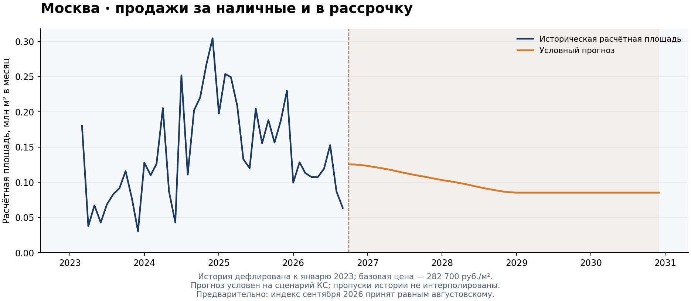

# Прогноз продаж новостроек Москвы

Модель прогнозирует продажи **за наличные средства и в рассрочку** при заданной траектории ключевой ставки. Итог — годовой объём в ценах января 2023 года и расчётная площадь продаж. Ипотечные сделки в прогноз этого проекта не входят.

**Данные по продажам:** январь 2023 — сентябрь 2026 · **Горизонт прогноза:** декабрь 2030 · **Python:** 3.10+



Бирюзовая пунктирная линия показывает оценки модели на исторических точках по последним коэффициентам Хьюбера. Это соответствие модели обучающей истории; качество прогнозирования оценивается отдельно в исторической проверке.

## Результат на данных за девять месяцев 2026 года

**Индекс цен обновлён по фактической выгрузке ДОМ.РФ за сентябрь 2026:** Москва / Общий / Все — 241,72054. Допущение «сентябрь = август» больше не применяется.

| Год | Объём в ценах января 2023, млрд руб. | Расчётная площадь, млн м² | Состав |
|---|---:|---:|---|
| 2026 | 382,4 | 1,353 | Январь–сентябрь: история; октябрь–декабрь: прогноз |
| 2027 | 387,7 | 1,372 | Прогноз |
| 2028 | 319,8 | 1,131 | Прогноз |
| 2029 | 289,6 | 1,025 | Прогноз |
| 2030 | 289,6 | 1,025 | Прогноз |

Это пример воспроизводимого расчёта на включённых данных, а не автоматически обновляемый прогноз. В сценарии на 2029–2030 годы КС равна 10%; при фиксированных коэффициентах годовые результаты одинаковы.

**Площадь расчётная:** реальные объёмы делятся на базовую цену **282 700 руб./м²**. Предполагается, что цена и ценовая динамика сегмента соответствуют общему рынку Москвы. Будущий прогноз цен для такого пересчёта не требуется.

## Запуск в браузере

[Открыть в GitHub Codespaces](https://codespaces.new/kR1SH1337/Real-Estate-Forecast)

1. Войдите в GitHub и создайте Codespace для ветки `main` либо откройте существующий через **Code → Codespaces**.
2. Дождитесь завершения настройки: Python и зависимости устанавливаются автоматически при создании среды.
3. В нижней панели **Terminal** выполните:

```bash
python cash_model.py
```

Годовая таблица появится в терминале и в **`results/forecast_annual.csv`**. Для скачивания найдите файл в панели слева, нажмите правой кнопкой и выберите **Download**.

В существующем Codespace сначала получите обновления командой `git pull --ff-only`. Если среда создана до появления автоматической настройки, выполните `python -m pip install -r requirements.txt`. Перед получением обновлений сохраните свои изменения. Использование Codespaces учитывается в лимитах вашего аккаунта GitHub.

## Запуск на компьютере

Скачайте репозиторий через **Code → Download ZIP** и распакуйте либо клонируйте его. Откройте терминал в папке проекта и выполните:

```bash
python -m pip install -r requirements.txt
python cash_model.py
```

В Windows при необходимости используйте `py` вместо `python`. Стандартные пути к данным и результатам определяются относительно скрипта.

## Обновление данных

Обновите файлы в `data/`, сохранив структуру столбцов CSV и листов Excel, затем запустите модель заново:

| Файл | Содержимое |
|---|---|
| `data/cash_sales.csv` | Очищенный номинальный ряд января 2023 — сентября 2026; извлечён из «ДДУ-Продажи», строка 13, млрд руб. |
| `data/price_assumptions.csv` | Историческое допущение для воспроизведения предварительной версии; сейчас не применяется |
| `data/provenance.json` | Источник, период, единицы и контрольная сумма исходной выгрузки |
| `data/macro_scenario.xlsx` | История и будущая траектория КС, лист «Москва», столбцы A–B |
| `data/price_index.xlsx` | Исторический индекс цен Москвы для дефлирования |

CSV продаж содержит колонки `date,nominal_bln_rub`. Также поддерживается непосредственное чтение исходной книги: `python cash_model.py --cash "Продажи и ипотека (1).xlsx" --prices "analytics_2699287266.xlsx"`. Выбираются номинальная строка «Кеш/рассрочки» на листе «ДДУ-Продажи» и общий индекс Москвы на листе «индекс».

Фактический индекс цены имеет приоритет над временным допущением. Для строгого запуска без допущений используйте `--no-price-assumptions`: текущий расчёт проходит без ценовых допущений; при отсутствии необходимого индекса программа остановится. Октябрь и другие новые месяцы автоматически не заполняются. Старый исходный ряд сохранён в `archive/cash_sales_2026-08.xlsx`.

КС должна покрывать необходимую историю и весь прогнозный горизонт. Код не изменяет исходные файлы. Результаты нового запуска сохраняются в `results/`; сохранение изменённых данных в GitHub выполняется отдельно.

## Метод и ограничения

[Диагностика стационарности от 23 октября 2026](docs/stationarity_2026-10-23.md): результаты чувствительны к лагам, тренду и выборке; устойчивость стационарности и порядок интегрированности обоих рядов не установлены. Риск неустойчивой регрессии в уровнях остаётся предметом проверки. Код и полный результат диагностики включены в репозиторий; прогноз по итогам этой проверки не менялся.

[Сравнение с моделями инерции продаж](docs/inertia_comparison_2026-10-23.md): ARX(1) почти не улучшает годовой WAPE; AR(1) снижает WAPE, но увеличивает RMSE. Текущая основная модель сохранена. Исследовательские прогнозы и проверки находятся отдельно в `reference_results/inertia/`; воспроизведение — `python scripts/compare_inertia.py`.

Основная спецификация — робастная регрессия Хьюбера на всей доступной истории. Фактор — средняя КС за три предыдущих месяца. Коэффициенты переоцениваются при обновлении истории и фиксируются на прогнозном горизонте.

Историческая проверка на следующих 12 месяцах: **WAPE 13,01%**, **MAPE 13,22%**, смещение **+13,01%**. Это показатели на десяти перекрывающихся горизонтах с известной будущей КС, а не независимая проверка реального прогнозирования. История содержит 44 пригодных наблюдения; ошибки восстановления продаж и структурные сдвиги ограничивают надёжность.

Прогноз условен на сценарий КС и сохранение оценённой связи. Площадь не является непосредственно наблюдаемой статистикой сделок. Различия структуры сегмента и общего рынка могут влиять на пересчёт в метры.

## Файлы и документация

| Путь | Назначение |
|---|---|
| `cash_model.py` | Код модели и точка запуска |
| `data/` | Исходные Excel-файлы |
| `reference_results/` | Контрольный расчёт на включённых исходных данных |
| `results/` | Новые результаты; создаётся при запуске, исключена из Git |
| `docs/` | Документация и график |
| `.devcontainer/` | Настройка среды Codespaces |
| `scripts/update_preview.py` | Перестроение графика из сохранённого расчёта |
| `archive/` | Первоначальный пакет; для запуска не используется |

- [Подробная инструкция: параметры, источники, формулы и диагностика](docs/usage.md)
- [Контрольный годовой прогноз](reference_results/forecast_annual.csv)
- [Подробное описание методологии в HTML — скачать и открыть в браузере](docs/model_description.html)

График в README построен по `reference_results/`. После нового расчёта его можно обновить командой `python scripts/update_preview.py --results results`; таблица и даты в README обновляются отдельно. `reference_results/` обновлён вместе с текущей выгрузкой; первоначальный ряд и пакет сохранены в `archive/`, а предыдущие результаты доступны в истории Git.

Проверки: `python -m unittest discover -s tests -v`.

[Подробности обновления от 21 октября 2026](docs/update_2026-10-21.md).

