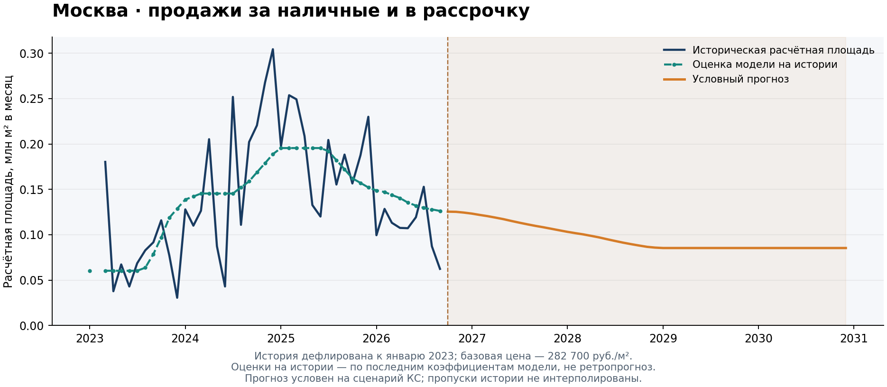

# Прогноз первичного рынка жилья Москвы

Три модели: продажи за наличные и в рассрочку, запуски новых проектов и динамика цен. У каждой свои исходные данные, документация и контрольные результаты. Python 3.10+.



График относится к модели кеш-продаж. Бирюзовая пунктирная линия — оценки на обучающей истории; качество прогнозирования оценивается отдельно.

| Модель | Метод и результат | Документация |
|---|---|---|
| [cash_installments](cash_installments/) — наличные и рассрочка | Робастная регрессия Хьюбера; объём в ценах января 2023 года и расчётная площадь до 2030 года | [Инструкция, результаты и ограничения](cash_installments/README.md) |
| [launches](launches/) — запуски новых проектов | Краткосрочная модель с инерцией и продажами; с 2027 года сценарий подстройки к ожидаемому спросу | [Методология и параметры](launches/README.md) |
| [price_forecast](price_forecast/) — цены первичного жилья | Калиброванная месячная модель: инфляция, временная корректировка и восстановление реального роста; прогноз до 2030 года | [График, результаты и методология](price_forecast/README.md) |

Метод распределения общего прогноза продаж по классам зафиксирован отдельно: [sales_decomposition — декомпозиция продаж](sales_decomposition/README.md). Это описание рабочего подхода; расчётный модуль пока не реализован.

## Быстрый запуск

[Открыть в GitHub Codespaces](https://codespaces.new/kR1SH1337/Real-Estate-Forecast). В новой среде зависимости устанавливаются автоматически. Для локальной установки выполните из корня репозитория:

```bash
python -m pip install -r requirements.txt
```

Продажи за наличные и в рассрочку:

```bash
python cash_installments/cash_model.py
```

Результаты: `cash_installments/results/`, годовая таблица — `forecast_annual.csv`.

Запуски:

```bash
python launches/model.py --input-json /path/to/local_snapshot.json
```

Результат: `launches/results/forecast.json`; также печатается в терминале. Пути к стандартным данным и результатам моделей определяются относительно скриптов, а не текущей папки терминала.

Цены первичного жилья:

```bash
python price_forecast/model.py
```

График и опубликованный прогноз: [price_forecast](price_forecast/).

## Данные и связь моделей

Кеш-продажи читают файлы из `cash_installments/data/`. Актуальные инструкции по обновлению источников, диагностика стационарности и сравнение моделей инерции сохранены внутри этого раздела.

Запуски читают локальный JSON-файл: квартальную историю запусков и отдельный прогноз **всех** продаж Москвы, включая ипотеку, кеш/рассрочку и one-off. Реальные входные данные и прогнозы запусков не включены в публичный репозиторий. Файл не заменяется автоматически результатом модели кеша: кеш — только один канал общих продаж. При обновлении общего прогноза нужно отдельно обновить локальный снимок запусков.

Для проверки установки есть синтетический пример, который не является прогнозом рынка:

```bash
python launches/model.py --input-json launches/examples/synthetic_input.json
```

Для модели запусков экспертно заданы скорость подстройки и учёт будущего спроса. Историческая проверка статистического блока не является проверкой долгосрочного сценария. Непроданные остатки и вводы пока не входят в расчёт запусков.

## Проверки и дополнительные расчёты

```bash
python -m unittest discover -s cash_installments/tests -v
python -m unittest discover -s launches/tests -v
python cash_installments/scripts/compare_inertia.py
```

Для отдельной диагностики стационарности:

```bash
python -m pip install -r requirements-diagnostics.txt
python cash_installments/scripts/stationarity_diagnostics.py
```

Обновление графика кеш-продаж из нового расчёта:

```bash
python cash_installments/scripts/update_preview.py --results cash_installments/results
```

`cash_installments/reference_results/` содержит опубликованные контрольные результаты кеш-модели. Папки `results/` создаются при запуске и исключены из Git. Исторические исходники кеш-модели сохранены в `cash_installments/archive/`; предыдущие версии проекта доступны в истории Git.

