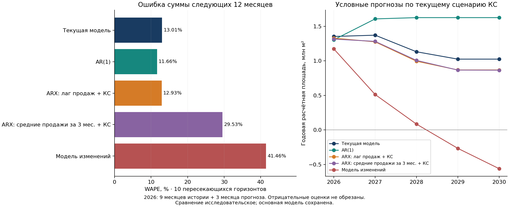

# Сопоставление моделей с инерцией продаж

Расчёт от 23 октября 2026 года, продажи и индекс цен по сентябрь 2026. Основная модель остаётся прежней: Хьюбер в реальных ценах января 2023 на всей истории. Новые оценки исследовательские; код основной модели и её контрольные прогнозы не заменены.

## Результат

Добавление лага продаж к КС почти не меняет годовую ошибку: WAPE 12,93% против 13,01% у текущей модели, при немного худшем RMSE. Автономная AR(1) без КС снижает WAPE до 11,66%, но увеличивает RMSE и меняет смещение с положительного на отрицательное. Модель с трёхмесячным средним лагированных продаж и протестированная модель изменений существенно хуже.

На этой проверке нет достаточного основания заменять основной Хьюбер динамической спецификацией. AR(1) полезна как дополнительный ориентир, ARX(1) — как проверка чувствительности к последним продажам. Преимущество по WAPE в десяти пересекающихся горизонтах не доказывает превосходства на новой независимой истории.

## Спецификации

Все Y — реальные млрд руб. в ценах января 2023; X — средняя КС трёх предыдущих месяцев в процентах. В основных вариантах используется один и тот же Хьюбер с c=1,345 и обновляемым MAD. Коэффициенты ниже оценены на последней доступной истории и фиксируются в прогнозе.

1. **Текущая статическая модель:** Y = −4,1635 + 2,8301X.
2. **AR(1), без КС:** Y = 16,3529 + 0,5730Y₋₁.
3. **ARX(1), продажи и КС:** Y = −11,5339 + 0,0841Y₋₁ + 3,0263X.
4. **ARX с трёхмесячной инерцией:** Y = −9,4362 + 0,2666 × mean(Y₋₁,Y₋₂,Y₋₃) + 2,4371X. Это усреднение регрессора, а не скользящее окно обучения.
5. **Модель изменений:** ΔY = −0,8162 − 0,4123ΔY₋₁ + 2,2339ΔX. Уровень восстанавливается накоплением прогнозируемых изменений от последнего известного Y.

Дополнительные ориентиры: статическая OLS, ARX(1) OLS, последнее значение продаж, фиксированное среднее последних 12 месяцев. Отдельная статическая модель Хьюбера оценивается на точно тех же строках обучения, что ARX(1), для контроля потери наблюдений при лагировании.

Инерционные коэффициенты 0,5730 у AR(1) и 0,0841 у ARX(1) оценены на одинаковых 42 наблюдениях. Разница показывает, что в этой спецификации лаг продаж добавляет сравнительно мало после включения КС. Это не доказательство экономического отсутствия инерции: данные восстановлены с ошибкой, а робастность по остатку не устраняет ошибку в лагированном регрессоре.

## Как проверяли

Десять одинаковых дат прогноза: декабрь 2024 — сентябрь 2025. На каждой дате переоценка только на доступной тогда истории, затем прогноз следующих 12 месяцев. Первый годовой горизонт — январь–декабрь 2025, последний — октябрь 2025 — сентябрь 2026. Сравниваются суммы следующих 12 месяцев, а не десять разных календарных лет.

Будущие фактические продажи не подставляются в лаги. Первый прогноз использует последнее известное наблюдение, второй — первый прогноз и далее рекурсивно. Для трёхмесячной инерции постепенно заменяются все три прошлых значения. Будущая КС при исторической проверке известна, как и в прежнем backtest. Дефляторы нужны для построения фактических реальных сумм, а не для получения будущей площади. Исторических версий данных и макропрогнозов нет: это условная проверка на пересмотренной базе.

Пропуск февраля 2023 сохранён. Регрессоры строятся через календарный shift до удаления невалидных строк: январь и март не становятся соседними месяцами. Число пригодных наблюдений последней оценки: текущая модель 44, AR/ARX(1) 42, трёхмесячная инерция 40, модель изменений 41. На первой дате проверки история значительно короче. Подбор по информационным критериям и автоматическое переключение между моделями не применялись.

## Годовая точность

| Модель | WAPE, % | MAPE, % | RMSE, млрд руб. | RMSE, млн м² | Смещение, % |
|---|---:|---:|---:|---:|---:|
| Текущий Хьюбер | 13,01 | 13,22 | 75,05 | 0,265 | +13,01 |
| AR(1), Хьюбер | 11,66 | 10,99 | 82,46 | 0,292 | −8,56 |
| ARX(1), Хьюбер | 12,93 | 12,84 | 76,21 | 0,270 | +12,93 |
| Трёхмесячная инерция + КС, Хьюбер | 29,53 | 27,61 | 219,71 | 0,777 | +29,53 |
| Изменения с лагом и ΔКС, Хьюбер | 41,46 | 40,29 | 268,63 | 0,950 | +13,75 |
| Статическая OLS | 12,20 | 12,49 | 70,49 | 0,249 | +12,20 |
| ARX(1), OLS | 12,72 | 12,67 | 73,82 | 0,261 | +12,72 |
| Среднее последних 12 месяцев | 28,75 | 30,75 | 172,41 | 0,610 | +25,73 |
| Последний месяц | 34,20 | 33,73 | 213,05 | 0,754 | +28,24 |
| Статический Хьюбер на строках ARX(1) | 13,10 | 13,03 | 76,84 | 0,272 | +13,10 |

AR(1) даёт меньшую абсолютную годовую ошибку на 6 из 10 дат, но особенно сильно недооценивает первые два горизонта: примерно на 150 и 168 млрд руб. Поэтому средняя абсолютная относительная ошибка снижается, а RMSE растёт. На длинном прогнозе модель возвращается к своему историческому среднему независимо от сценария КС.

ARX(1) также выигрывает у текущего Хьюбера по абсолютной ошибке на 6 из 10 дат, но разница WAPE всего 0,08 п.п.; положительное смещение сохраняется во всех десяти горизонтах. На обучении, при одинаковых 42 точках, месячный RMSE статической модели 14,108, ARX(1) — 14,035 млрд руб. Улучшение соответствия обучающей истории очень небольшое. В исторических переоценках коэффициент Y₋₁ колеблется от −0,040 до 0,108; устойчивой большой положительной инерции в этой спецификации нет. Доверительные интервалы этих динамических параметров отдельно не оценивались.

Трёхмесячная инерция особенно завышает первые горизонты: на первой дате коэффициент при среднем лагированных продаж равен 0,786 против 0,267 в текущей оценке. Более гладкий регрессор не гарантирует лучшей прогнозной точности.

У модели изменений знак и величина константы заметно меняются между переоценками; ошибки накапливаются при восстановлении уровня. Сравнение относится к конкретной спецификации с константой, а не ко всем возможным моделям изменений.

## Дополнительные горизонты и начало истории

| Модель | WAPE суммы 1 мес., % | 3 мес., % | 6 мес., % | 12 мес., % |
|---|---:|---:|---:|---:|
| Текущий Хьюбер | 18,74 | 16,48 | 12,62 | 13,01 |
| AR(1) | 20,61 | 18,63 | 13,69 | 11,66 |
| ARX(1), Хьюбер | 20,27 | 16,82 | 14,77 | 12,93 |

Это те же десять дат, а не увеличенная выборка коротких прогнозов. ARX(1) не улучшает результаты автоматически даже на коротком горизонте.

Если начинать всю историю с марта 2023, без одиночного января перед пропуском, WAPE статического Хьюбера составляет 13,02%, ARX(1) — 12,93%. Вывод о малой разнице сохраняется.

Если оставить только обучение с июля 2024, для одинаковых четырёх дат июнь–сентябрь 2025: WAPE статического Хьюбера 45,09%, ARX(1) 25,75%, AR(1) 43,45%. Однако на тех же четырёх датах обучение на всей истории даёт соответственно 10,66%, 7,48% и 7,30%. Доступны лишь 12–15 месяцев нового режима, поэтому это слабая проверка, но она не поддерживает механическое исключение старой истории. Полные результаты остальных моделей сохранены в JSON; отдельные переоценки короткого режима могут быть динамически неустойчивы, коэффициенты не ограничивались искусственно.

## Условные прогнозы при текущем сценарии КС

Площадь — реальные млрд руб. / 282,7. Это сценарные оценки разных спецификаций, не прогнозный интервал и не новая основная версия.

| Год | Текущая, млн м² | AR(1), млн м² | ARX(1), млн м² | Трёхмесячная инерция, млн м² | Изменения, млн м² |
|---|---:|---:|---:|---:|---:|
| 2026: 9 мес. истории + 3 мес. прогноза | 1,3528 | 1,3045 | 1,3285 | 1,3145 | 1,1723 |
| 2027 | 1,3713 | 1,6072 | 1,2749 | 1,2818 | 0,5120 |
| 2028 | 1,1312 | 1,6256 | 0,9945 | 1,0064 | 0,0837 |
| 2029 | 1,0246 | 1,6256 | 0,8681 | 0,8662 | −0,2673 |
| 2030 | 1,0246 | 1,6256 | 0,8680 | 0,8644 | −0,5616 |

У ARX(1) текущий год — 375,57 млрд руб., 2027 — 360,41 млрд руб. в постоянных ценах. Долгосрочная чувствительность к КС β/(1−φ)=3,304 млрд руб. на п.п.; краткосрочная β=3,026. Она не является причинной эластичностью спроса.

**Контроль одинаковой выборки важен:** статический Хьюбер после удаления тех же двух точек, которые теряет ARX(1), даёт на 2027 год 1,2835 млн м², на 2030 — 0,8810 млн м². Это близко к ARX(1), 1,2749 и 0,8680. Значительная часть отличия долгосрочного прогноза от исходной модели обусловлена изменением обучающей выборки, а не самим механизмом инерции. Удалять эти точки из основной модели по данному результату не предлагается.

У модели изменений первый отрицательный месячный прогноз возникает в сентябре 2028. При постоянной КС её ожидаемое месячное изменение стремится к −0,578 млрд руб.; накопление приводит к отрицательному уровню. Значения не обрезаны. В протестированном виде она непригодна для основного прогноза до 2030.



## Что это означает после диагностики стационарности

Лаг продаж добавляет динамику, но не снимает автоматически риск нестационарности и ложной связи. Все текущие AR-компоненты в уровнях динамически устойчивы при фиксированной КС; это не означает стационарность Y при нестационарном X. У модели изменений устойчивость компонента ΔY не устраняет накопление ошибок в уровне.

Результаты позволяют сохранить простой Хьюбер как рабочую основную модель, AR(1) и ARX(1) — как сравнительные оценки. Статическая OLS здесь немного лучше по метрикам, поэтому утверждать, что Хьюбер статистически победил все варианты, нельзя. Его прежний выбор также опирался на ограничение влияния ошибок восстановленного ряда.

Десять годовых горизонтов сильно перекрываются; почти весь проверочный период принадлежит одному режиму. По ним нельзя надёжно проверить превосходство модели или устойчивость связи до 2030. Проверка нескольких спецификаций на той же истории делает результаты исследовательскими. Следующая важная информация — новые фактические месяцы и накопление независимых годовых горизонтов.

## Воспроизведение

```bash
python scripts/compare_inertia.py
```

Дополнительных зависимостей сверх `requirements.txt` не требуется. Результаты находятся в `reference_results/inertia/`: годовые и месячные прогнозы, backtest, проверки начала истории, метрики, коэффициенты, попарное сравнение и график. SHA-256 источников записаны в `summary.json`.

Проверки внутри скрипта: совпадение всех десяти годовых прогнозов исходной модели с сохранённым backtest; совпадение обобщённой реализации Хьюбера с исходным оценивателем; ручная проверка первых двух рекурсивных шагов ARX; отсутствие зависимости прогноза от подменённых будущих продаж. Основные `cash_model.py` и прогнозные файлы вне подпапки `inertia/` не изменяются.
