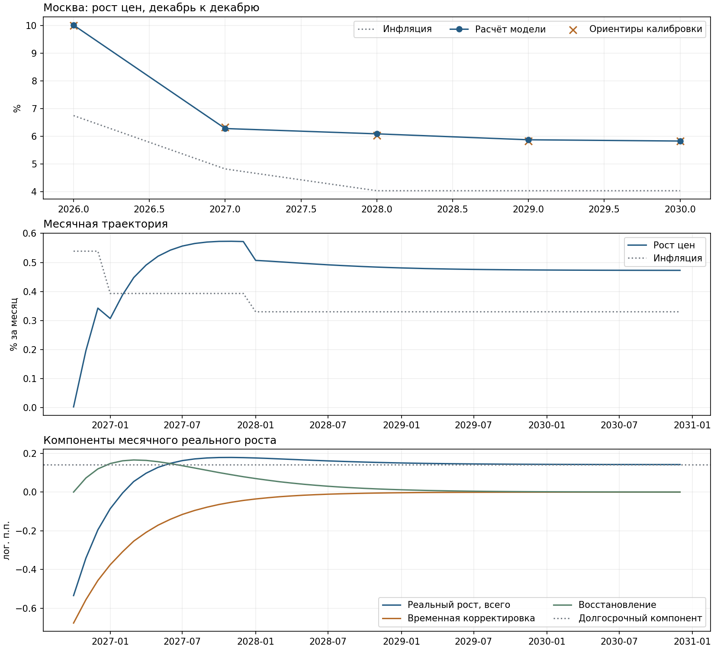

# Прогноз цен первичного жилья Москвы

Калиброванная модель динамики индекса цен ДОМ.РФ до 2030 года. Расчёт от 26.10.2026, факт — по сентябрь 2026 года. Годовые ориентиры используются как мягкие условия калибровки; прогноз рассчитывается по единой месячной формуле.



## Результат

Рост цен и инфляция — декабрь к декабрю, премия — их разность.

| Год | Инфляция | Рост цен модели | Премия к инфляции |
|---|---:|---:|---:|
| 2026 | 6,75% | **10,01%** | 3,27 п.п. |
| 2027 | 4,82% | **6,28%** | 1,46 п.п. |
| 2028 | 4,03% | **6,09%** | 2,05 п.п. |
| 2029 | 4,03% | **5,87%** | 1,84 п.п. |
| 2030 | 4,03% | **5,83%** | 1,79 п.п. |

Октябрь–декабрь 2026: +0,54% к сентябрю. Точная [годовая таблица](reference_results/annual_forecast.csv) и [месячный прогноз](reference_results/monthly_forecast.csv) доступны в CSV.

## Как работает спецификация

Модель описывает переход от временного затишья после сентября 2026 года к восстановлению реального роста цен, а затем к долгосрочному темпу. В ней четыре параметра на все 51 прогнозный месяц. Независимых коэффициентов для каждого прогнозного года нет.

### 1. Что задано на входе

| Вход | Роль в расчёте |
|---|---|
| Фактический индекс цен ДОМ.РФ по сентябрь 2026 года | Начальный уровень прогнозной траектории и накопленный рост текущего года |
| Прогноз ИПЦ | Инфляционный компонент будущего роста цен |
| Рост цен около 10% за 2026 год | Ближайший ориентир калибровки |
| Премии к инфляции 1,5; 2,0; 1,8; 1,8 п.п. в 2027–2030 годах | Мягкие ориентиры годовых результатов |
| Долгосрочная премия около 1,8 п.п., не выше 2 п.п. | Центр регуляризации и верхняя граница долгосрочного параметра |

Годовой ориентир после 2026 года рассчитывается как инфляция плюс соответствующая премия. Например, для 2027 года: 4,820% + 1,5 п.п. = 6,320%. Он участвует в подборе параметров, но не подставляется в готовую месячную траекторию.

### 2. Номинальный рост разделён на инфляцию и реальный рост

$$
g_h=\pi_h+r_h,
$$

где $g_h=100\ln(P_h/P_{h-1})$ — месячный логарифмический рост индекса цен, $\pi_h$ — аналогичный рост ИПЦ, $r_h$ — рост цен жилья за вычетом инфляции. Все три величины измерены в логарифмических процентных пунктах за месяц. Обычный месячный прирост в процентах равен $100[\exp(g_h/100)-1]$.

Первый прогнозный месяц — октябрь 2026 года, ему соответствует $h=0$. Ноябрь — $h=1$, декабрь — $h=2$. Сентябрьский скачок остаётся в фактическом уровне индекса, но его темп не переносится автоматически на будущие месяцы.

Для этой версии прогнозная инфляция распределена равномерно в логарифмических темпах внутри каждого года. В 2026 году распределяется только прирост ИПЦ оставшегося квартала. Декабрьские уровни и годовые темпы исходного макропрогноза сохраняются. Поэтому месячный профиль условный, сезонность отдельно не оценена; переходы инфляции между годами могут давать ступеньки номинального темпа.

### 3. Реальный рост определяется одной переходной функцией

$$
r_h=\mu+a\exp(-h/\tau)+b\frac{h}{\tau}\exp(-h/\tau).
$$

| Компонент | Что означает | Как меняется |
|---|---|---|
| $\mu$ | Долгосрочный месячный реальный рост | Постоянен на горизонте |
| $a\exp(-h/\tau)$ | Временная отрицательная корректировка после сентября | При $a<0$ постепенно приближается к нулю |
| $b(h/\tau)\exp(-h/\tau)$ | Временный компонент восстановления | Начинается с нуля, усиливается, затем затухает |

Экономическая гипотеза: сентябрь мог перетянуть часть будущего спроса, поэтому ближайший реальный рост слабый. Затем этот эффект ослабевает, рост восстанавливается и может временно превысить долгосрочный темп. Позднее оба переходных компонента исчезают.

Это интерпретация выбранной формы кривой. Коэффициенты переноса спроса и восстановления не оценивались по продажам. В этой версии нет уравнений спроса, предложения или причинной эластичности цен по запасу жилья.

### 4. Четыре параметра определяют всю форму прогноза

| Параметр | Значение | Интерпретация |
|---|---:|---|
| $\delta$ | 1,786 п.п. | Долгосрочное превышение номинального роста цен над инфляцией при инфляции 4% |
| $a$ | −0,676 лог. п.п./мес. | Начальная отрицательная корректировка реального темпа |
| $b$ | 0,451 лог. п.п./мес. | Масштаб временного восстановления |
| $\tau$ | 5,09 месяца | Общий масштаб времени для двух переходных компонентов |

В отличие от $a$, коэффициент $b$ не равен пиковому вкладу своего компонента. Максимум восстановления достигается при $h=\tau$ и равен $b/e$, то есть примерно 0,166 лог. п.п. в месяц. Модуль отрицательной корректировки сокращается вдвое за $\tau\ln2$, здесь примерно за 3,53 месяца. Это свойство принятой функции, не оценка срока восстановления фактических продаж.

Общий реальный рост достигает максимума позднее, чем отдельный компонент восстановления: отрицательная корректировка продолжает ослабевать. В опубликованной траектории максимум месячного реального роста приходится на конец 2027 года. Повышенная годовая премия в 2028 году совместима с этим, поскольку годовой результат агрегирует все месяцы года.

### 5. Как годовая премия переводится в месячный темп

Постоянный компонент определяется через долгосрочную премию:

$$
\mu=\frac{100}{12}\ln\left(\frac{104+\delta}{104}\right).
$$

При $\delta=1{,}786$ получаем $\mu\approx0{,}142$ лог. п.п. в месяц. Если инфляция равна 4% и переходные эффекты исчезли, цены растут примерно на 5,786% в год.

Это точный перевод **премии в процентных пунктах**, а не деление реального роста 1,786% на 12. При инфляции, отличной от 4%, фактическая номинальная премия немного отличается из-за мультипликативного накопления. Предел 2 п.п. применяется к параметру $\delta$, а не к каждой годовой премии на переходном участке. Поэтому премия 2028 года может составлять 2,05 п.п.

### 6. Как подбираются параметры

Для каждого набора $(\delta,a,b,\tau)$ программа строит все месячные темпы, рассчитывает уровни индекса и получает пять годовых приростов. Затем выбирает параметры, минимизирующие функцию:

$$
J=\sum_{y=2026}^{2030}\left(\frac{G_y-\bar G_y}{s_y}\right)^2
+\left(\frac{\delta-1{,}8}{0{,}2}\right)^2
+\left(\frac{\tau-9}{6}\right)^2
+\left(\frac{b}{1}\right)^2.
$$

Здесь $G_y$ — результат модели, $\bar G_y$ — годовой ориентир, $s_y$ — масштаб штрафа: 0,25 п.п. для 2026 года и 0,4 п.п. для последующих лет. Меньший масштаб означает больший вес ориентира. Эти числа заданы экспертно: они не являются стандартными ошибками, доверительными интервалами или жёсткими допусками.

Последние три слагаемых — регуляризация. Они удерживают долгосрочную премию около 1,8 п.п., масштаб затухания около 9 месяцев и ограничивают чрезмерную амплитуду восстановления. Отклонение допустимо: например, полученное $\tau=5{,}09$ отличается от центра регуляризации 9 месяцев. При подборе используются границы $0\leq\delta\leq2$, $-2\leq a\leq0$, $0\leq b\leq2$, $2\leq\tau\leq24$.

Именно совместная форма кривой и штрафы не позволяют независимо закрепить каждый год на желаемом значении. Максимальное отклонение годового результата от ориентира в базовой калибровке — около 0,054 п.п. Эта близость показывает выполнение задачи калибровки, но сама по себе ничего не говорит о будущей точности.

### 7. Как месячные темпы превращаются в годовой прогноз

От последнего фактического уровня рассчитывается каждый последующий месяц:

$$
P_h=P_{\text{сен.2026}}\exp\left(\frac{1}{100}\sum_{j=0}^{h}g_j\right).
$$

Годовой рост — отношение декабрьских уровней:

$$
G_y=100\left(\frac{P_{\text{дек.}y}}{P_{\text{дек.}(y-1)}}-1\right).
$$

Поэтому рост за 2026 год включает фактические девять месяцев. Накопленные +9,421% и прогнозные +0,542% за IV квартал дают около +10,015% за год через перемножение, а не сложение.

Пример расчёта первого прогнозного месяца:

| Октябрь 2026 года | Вклад, лог. п.п. за месяц |
|---|---:|
| Инфляция | +0,53724 |
| Долгосрочный реальный компонент | +0,14186 |
| Временная корректировка | −0,67637 |
| Восстановление при $h=0$ | 0 |
| **Номинальный рост, сумма** | **+0,00273** |

Это почти нулевая номинальная динамика октября при снижении реальных цен. В ноябре и декабре отрицательная корректировка ослабевает, и обычные месячные приросты достигают примерно 0,20% и 0,34%. Точные месячные значения условны и зависят, в частности, от принятой разбивки инфляции.

### 8. Что в результате рассчитано, а что предположено

Фактический индекс определяет начальный уровень. Макросценарий определяет будущую инфляцию. Экспертно заданы форма перехода, годовые ориентиры, границы и регуляризация. Четыре параметра, месячная траектория, годовые приросты и фактические годовые премии получены расчётным путём на этой основе. Все четыре параметра откалиброваны, а не независимо оценены по исторической регрессии.

Проверка зависимости от предпосылок показала:

- Без ориентира только 2027 года, при сохранении остальных, рост этого года снижается с 6,28% до 5,15%.
- Если сохранить только ориентир 2026 года и регуляризацию, рост 2027 года составляет 3,67%.
- Если при неизменных параметрах повысить годовую инфляцию на 1 п.п., рост цен 2027 года повышается до 7,29%. Это механический перенос инфляции при прежней траектории реального роста; обратное влияние инфляции на спрос не моделируется.

Следовательно, модель позволяет согласовать предпосылки в единой динамике и рассчитывать чувствительность, но не подтверждает независимо выбранные премии. Историческая прогнозная точность новой конструкции пока не проверена. Результат корректно описывать как **прогноз на основе калиброванной модели динамики цен**.

Подробнее: [методология, данные и ограничения](METHODOLOGY.md).


## Запуск

Из корня репозитория, Python 3.10+:

```bash
python -m pip install -r price_forecast/requirements.txt
python price_forecast/model.py
```

Новые результаты сохраняются в `price_forecast/results/`. Путь не зависит от текущей папки терминала. Опубликованный расчёт сохранён отдельно в `reference_results/` и при запуске не перезаписывается.

## Проверки и чувствительность

- [Параметры](reference_results/parameters.csv) и [настройки калибровки](reference_results/calibration_config.json).
- [Изменение веса и исключение годовых ориентиров](reference_results/calibration_sensitivity.csv).
- [Инфляция и временная корректировка при неизменных параметрах](reference_results/fixed_parameter_scenarios.csv).
- [Проверки вычислений и сходимости](reference_results/validation.json).

При запуске проверяются сложение компонентов роста, переход к уровням индекса, долгосрочный предел и сходимость оптимизации из 17 начальных приближений. Эти проверки не являются проверкой исторической точности.
