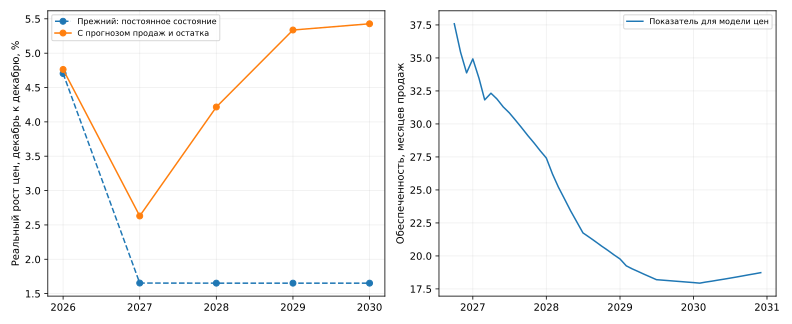

# Прогноз цен первичного жилья Москвы

**Обновлено 27.10.2026:** к модели реального роста цен подключён согласованный прогноз продаж и непроданного строительного портфеля из раздела [portfolio_forecast](../portfolio_forecast/README.md). Коэффициенты ценовой модели, три группы dummy и макросценарий инфляции сохранены. Целевые годовые темпы цен в расчёте не используются.

## Текущий результат

Вариант для продолжения предыдущего расчёта — обеспеченность предложением с лагом 1, без сезонных контролей (`mos_lag1`).

| Год | Инфляция | Реальный рост цен | Номинальный рост цен |
|---|---:|---:|---:|
| 2026 | 6,75% | **4,76%** | **11,83%** |
| 2027 | 4,82% | **2,63%** | **7,58%** |
| 2028 | 4,03% | **4,22%** | **8,42%** |
| 2029 | 4,03% | **5,34%** | **9,59%** |
| 2030 | 4,03% | **5,43%** | **9,68%** |

Все темпы — декабрь к декабрю. Факт цен сохранён по сентябрь 2026, дефлятор — ИПЦ РФ. Реальный рост рассчитывается через отношение индексов, не простую разность процентов.



Продажи в исходном прогнозе растут с 2,652 млн м² в 2026 до 3,327 млн м² в 2030, непроданный остаток на конец года сокращается с 7,676 до 5,239 млн м². Снижение обеспеченности относительно продаж модель трактует как ослабление давления предложения и ускорение реального роста цен. Прежнее удержание текущего показателя рынка давало номинально 6,55% в 2027 и 5,75% далее; оно заменено согласованной траекторией.

**Статус:** условный прогноз при заданных продажах и портфеле. Коэффициент рынка чувствителен к выборке, а историческая ошибка при его добавлении не улучшилась. Это обновление входов, не подтверждение точности спецификации. Обратное влияние цен на продажи и портфель не решается автоматически.

[Подробное описание нового расчёта](market_state/LINKED_FORECAST.md) · [Годовые результаты](market_state/linked_results/annual_forecast.csv) · [Код подключения](market_state/linked_forecast.py) · [Чувствительность месячного распределения](market_state/linked_results/monthly_bridge_sensitivity.csv).

## Что подключено

Использованы суммарные строки «Всего» из [итогового баланса](../portfolio_forecast/reference_results/forecast_by_class.csv) и [снимок на 27 октября](../portfolio_forecast/inputs/snapshot_2026-10-27.json), согласованные с техническим Excel. Входные копии и происхождение сохранены в `market_state/inputs/`. Снимок портфеля — на 23.10.2026, исторический ряд цен — по сентябрь. Годовые продажи и конечные остатки согласованы точно; месячные входы получены явным техническим распределением и интерполяцией. Расчёт портфеля в другом разделе не изменён.

## Воспроизведение

Python 3.10+, из корня репозитория:

```bash
python -m pip install -r price_forecast/requirements.txt
python price_forecast/market_state/linked_forecast.py
```

Для подстановки актуальных соседних файлов напрямую:

```bash
python price_forecast/market_state/linked_forecast.py --portfolio-csv portfolio_forecast/reference_results/forecast_by_class.csv --portfolio-snapshot portfolio_forecast/inputs/snapshot_2026-10-27.json
```

## Спецификации и предыдущие проверки

- [Показатели рынка, оценка коэффициентов и историческая проверка](market_state/README.md), [код оценки](market_state/model.py). Этот запуск переоценивает коэффициенты, поэтому отделён от подключения входного прогноза.
- [Очистка всей истории и три группы dummy](shock_normalization/FULL_HISTORY.md), [код](shock_normalization/full_history.py), [разметка](shock_normalization/full_history_results/calendar.csv).
- [Хьюбер и регуляризация](shock_normalization/ROBUSTNESS.md).
- [Первый календарный эксперимент](shock_normalization/README.md) и [продолжительный эпизод сентября 2025 — января 2026](shock_normalization/EXPERT_WAVE.md).
- [Статистическая модель с мягкими годовыми ориентирами](statistical/README.md).
- [Первоначальная сценарная калибровка](LEGACY_CALIBRATED_README.md), [методология](METHODOLOGY.md), [код](model.py), [прежние контрольные результаты](reference_results/annual_forecast.csv).

Предыдущие варианты сохранены для сравнения. Они используют разные предпосылки и не являются оценками одной неизменной спецификации.
