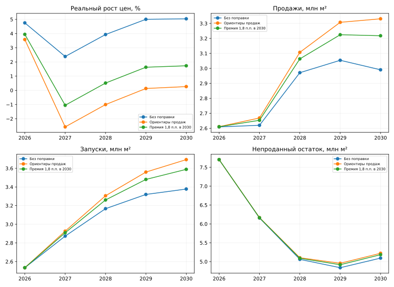

# Прогноз цен первичного жилья Москвы

> **Статус на 28.10.2026.** Сохраняется совместная система цен, продаж, запусков и портфеля. **α зафиксирована на 75%.** [Последняя проверка — вес будущих продаж ω = 50/75/100%](market_state/OMEGA_EQUILIBRIUM.md). Значение ω и ценовая спецификация пока не выбраны окончательно.
>
> **Таблица ниже с поправкой κ — архивный сценарный эксперимент. Он не выбран базовым прогнозом.** [Статистическая диагностика исходных функций](market_state/statistical_comparison_results/README.md) и [полная история сравнения](market_state/annual_model_comparison/README.md).

**27.10.2026: откалибровано совместное решение цен, продаж, запусков и непроданного портфеля.** Одна сценарная поправка к автономному реальному росту цен подбирается по ориентирам продаж из последнего Excel. На каждом шаге заново решаются все четыре зависимости. Исторические коэффициенты реакции на рынок, инерция и dummy сохранены.

## Архив: калибровка по ориентирам продаж

| Год | Реальный рост цен | Номинальный рост цен | Продажи, млн м² | Запуски, млн м² | Непроданный остаток на конец года, млн м² |
|---|---:|---:|---:|---:|---:|
| 2026 | 3,58% | 10,57% | 2,611 | 2,534 | 7,704 |
| 2027 | −2,57% | 2,12% | 2,669 | 2,926 | 6,167 |
| 2028 | −1,00% | 2,99% | 3,107 | 3,306 | 5,103 |
| 2029 | 0,13% | 4,17% | 3,308 | 3,560 | 4,956 |
| 2030 | 0,27% | 4,31% | 3,331 | 3,694 | 5,222 |

Темпы цен — декабрь к декабрю, площади — полный год. Факт девяти месяцев 2026 сохранён; этот год исключён из цели подбора. Продажи являются результатом системы: одна постоянная поправка приближает их к Excel, но не фиксирует каждый год точно.

По сравнению с решением без поправки в 2030 рост цен снижен с 9,28% до 4,31%, продажи повышены с 2,990 до 3,331 млн м², запуски — с 3,378 до 3,694 млн м², непроданный остаток — с 5,093 до 5,222 млн м². Остаток выше исходного сценария с 2027 года, хотя продолжает сокращаться до 2029. Запуски 2026 фиксированы, поэтому в этом году дополнительный спрос немного уменьшает остаток.

**Цена приближения к ориентирам продаж — отрицательная реальная динамика цен в 2027–2028.** Более мягкий вариант сохраняет премию номинального роста к инфляции 1,8 п.п. в 2030: рост цен 5,83%, продажи 3,218 млн м², запуски 3,589 млн м² и остаток 5,184 млн м². Одновременно точно выполнить все годовые ориентиры продаж и этот ориентир премии одной поправкой не получается.



Поправка раскрыта как сценарная предпосылка. Её подбор и сходимость системы не подтверждают улучшения прогнозной точности. Рублёвые ипотечные номиналы, площади кеша/рассрочек и one-off, инфляция и функции портфеля сохранены. Индекс переведён в рублёвую цену с опорой на среднюю цену 2025 года; чувствительность этой привязки остаётся ограничением.

[Методика калибровки](market_state/CALIBRATED_EQUILIBRIUM.md) · [Годовые результаты трёх сценариев](market_state/calibrated_results/annual_comparison.csv) · [Код](market_state/calibrated_equilibrium.py) · [Архитектура четырёх блоков](market_state/SYSTEM.md) · [Совместный прогноз без поправки](market_state/COUPLED_FORECAST.md).

## Запуск калибровки

```bash
python -m pip install -r price_forecast/requirements.txt
python price_forecast/market_state/calibrated_equilibrium.py
```

Результаты сохраняются в `market_state/calibrated_results/`. Для передачи в модель портфеля используйте `sales_guidance_fit_portfolio_snapshot.json` или `premium_1_8pp_2030_portfolio_snapshot.json` из этой папки. Исходный портфель другого раздела не заменён.

## Запуск сценария без поправки

Python 3.10+, из корня репозитория:

```bash
python -m pip install -r price_forecast/requirements.txt
python price_forecast/market_state/coupled_forecast.py
```

Агрегированные каналы из Excel включены в `market_state/inputs/channel_forecast_2026-10-27.json`. Полный Excel для запуска не нужен. Согласованные результаты записываются в `market_state/coupled_results/`. Снимок исходного портфеля и его механизм используются как входы; обновлённый баланс сохранён в результатах согласования, а не заменяет исходную версию другого раздела.

Для воспроизведения нового баланса кодом раздела портфеля:

```bash
python portfolio_forecast/model.py --input-json price_forecast/market_state/coupled_results/portfolio_snapshot_equilibrium.json --output-dir /tmp/moscow_equilibrium_portfolio
```

## Предыдущие этапы

- [Одностороннее подключение согласованных продаж и остатка](market_state/LINKED_FORECAST.md), [код](market_state/linked_forecast.py). Там продажи ещё не зависели от результата ценовой модели.
- [Показатели рынка, оценка коэффициентов и историческая проверка](market_state/README.md), [код оценки](market_state/model.py). Переоценка коэффициентов отделена от текущего согласования.
- [Очистка всей истории и три группы dummy](shock_normalization/FULL_HISTORY.md), [код](shock_normalization/full_history.py), [разметка](shock_normalization/full_history_results/calendar.csv).
- [Хьюбер и регуляризация](shock_normalization/ROBUSTNESS.md).
- [Календарный эксперимент](shock_normalization/README.md), [продолжительная волна 2025–2026](shock_normalization/EXPERT_WAVE.md).
- [Статистическая модель с мягкими ориентирами](statistical/README.md).
- [Первоначальная сценарная калибровка](LEGACY_CALIBRATED_README.md), [методология](METHODOLOGY.md), [код](model.py).

Все этапы сохранены для сравнения; их предпосылки и смысл результатов различаются.
