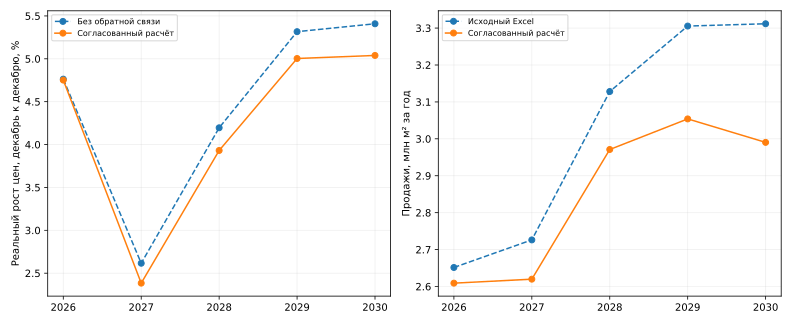

# Согласование цен, продаж и непроданного портфеля

Версия **27.10.2026**, источник каналов — новый файл пользователя `Продажи и ипотека (1).xlsx`. В нём повышены номинальные объёмы ипотечных сделок. По этой версии выполнен полный итерационный пересчёт цен, продаж в площади, запусков, вводов и портфеля. Коэффициенты ценовой модели не переоцениваются.

## Итог

| Год | Номинальный рост цен | Реальный рост цен | Продажи в исходном Excel, млн м² | Согласованные продажи, млн м² | Непроданный остаток на конец года, млн м² |
|---|---:|---:|---:|---:|---:|
| 2026 | **11,82%** | **4,75%** | 2,652 | **2,609** | **7,705** |
| 2027 | **7,32%** | **2,38%** | 2,726 | **2,620** | **6,157** |
| 2028 | **8,12%** | **3,93%** | 3,128 | **2,971** | **5,060** |
| 2029 | **9,24%** | **5,00%** | 3,305 | **3,054** | **4,839** |
| 2030 | **9,28%** | **5,04%** | 3,312 | **2,990** | **5,093** |

Рост цен — декабрь к декабрю. Продажи и потоки — за полный год, остатки — на конец года. Исходный Excel немного отличается от ранее округлённого снимка портфеля: после повышения ипотеки в нём также изменены ценовые предпосылки. Для этого расчёта исходной версией служат именно данные нового файла, с полной точностью.



Внутри согласования рублёвый ипотечный прогноз, ПВ, кеш и one-off фиксированы. Более высокая средняя цена уменьшает ипотечную площадь. Снижение продаж меняет запуски, вводы и непроданный остаток, а затем возвращается в ценовое уравнение. Сокращение запусков одновременно уменьшает будущее предложение, поэтому обратная связь смягчает ценовую траекторию, но не устраняет позднее ускорение.

## Компоненты из нового Excel

| Год | Сумма ипотечных сделок с учётом ПВ, млрд руб. | Кеш/рассрочки с one-off, тыс. м² |
|---|---:|---:|
| 2026 | 612,752 | 1 354,086 |
| 2027 | 688,481 | 1 371,418 |
| 2028 | 882,432 | 1 485,320 |
| 2029 | 1 128,833 | 1 307,747 |
| 2030 | 1 201,742 | 1 290,060 |

Источник: лист «ДДУ-Продажи», E43:I43 — сумма ипотечных сделок, E63:I63 — кеш/рассрочки в площади. Кеш уже включает one-off из E51:I51: 0 / 0 / 100 / 80 / 75 млрд руб. в ценах базового года. Он переведён в площадь по 282,7 тыс. руб./м² и на новую номинальную цену не делится. ПВ повторно не начисляется.

Входы, адреса ячеек и SHA-256 исходного Excel сохранены в [агрегированном снимке](inputs/channel_forecast_2026-10-27.json). Для воспроизведения исходный Excel не требуется.

## Как замкнут расчёт

Для 2027–2030 годов:

$$
Q_y^{ипотека}=1000\frac{V_y^{сделок}}{\bar p_y},\qquad
Q_y=Q_y^{ипотека}+Q_y^{кеш/рассрочки}.
$$

V измеряется в млрд руб., p — в тыс. руб./м², Q — в тыс. м². Средняя цена p получается из месячной траектории; она не равна декабрьской цене. Равномерное распределение площадей по месяцам согласуется с арифметической средней месячных цен: сумма подразумеваемых месячных денежных объёмов равна годовому номиналу.

Для 2026 года сохранён фактический период январь–сентябрь: ипотечная площадь 1 040,876 тыс. м², кеш/рассрочки 917,085 тыс. м². Из годового ипотечного номинала вычтены уже состоявшиеся сделки 500,097 млрд руб. Оставшиеся 112,655 млрд делятся на среднюю прогнозную цену IV квартала, взвешенную по числу дней. Фактические ипотечные метры заново по новой цене не пересчитываются. Поэтому результат 2026 отличается также из-за корректного разделения факта и прогнозного квартала, а не только изменения годового темпа.

Индекс цен сам по себе не даёт рублёвую цену метра. Основная привязка сохраняет фактическую среднюю цену 2025 года из D55 нового Excel: 427,791 тыс. руб./м². Она сопоставлена со средним индексом 2025 года, взвешенным фактическими площадями продаж. Этим фиксируется масштаб индекса; дальше месячная рублёвая цена меняется пропорционально его траектории. Это расчётная сопоставимая цена, а не наблюдаемая цена каждой ипотечной сделки.

### Итерация

1. По предполагаемой месячной траектории цен рассчитываются ипотечные метры и общий годовой объём продаж.
2. Неизменённый алгоритм портфеля получает новый объём продаж: повторно рассчитываются запуски, доли классов, вводы, продажи по группам ввода и конечные остатки.
3. Из годовых продаж и остатков строится месячный показатель обеспеченности. Факты, срез 23 октября, правила 69/92 и месячного распределения сохранены.
4. Прежнее ценовое уравнение даёт новую месячную траекторию.
5. В следующую итерацию принимается геометрическая середина старой и новой траекторий. Расчёт повторяется до сходимости.

Весь горизонт пересчитывается совместно: запуски зависят от продаж текущего и следующего года. Для границы горизонта, как и в исходном портфельном расчёте, продажи 2031 приравнены к обновлённым продажам 2030. Исторические коэффициенты распределения и профили вводов не переоцениваются.

Итерации сошлись за **21 шаг** при весе обновления 0,5. Максимальное логарифмическое расхождение текущих и повторно рассчитанных месячных цен — 4,96×10⁻⁹. Повторение с весами 0,25 и 1 и стартовыми ценами на 15% ниже/выше дало те же результаты в пределах численного допуска. Это проверка согласованности расчёта, не оценка его экономической точности.

## Согласованный портфель

| Год | Запуски, тыс. м² | Вводы, тыс. м² | Портфель на конец года, тыс. м² | Распроданность |
|---|---:|---:|---:|---:|
| 2026 | 2 534 | 5 305 | 13 961 | 44,81% |
| 2027 | 2 873 | 5 553 | 11 265 | 45,34% |
| 2028 | 3 167 | 4 580 | 9 839 | 48,57% |
| 2029 | 3 320 | 3 501 | 9 647 | 49,84% |
| 2030 | 3 378 | 2 744 | 10 270 | 50,41% |

Здесь использована копия расчётного блока `portfolio_forecast/model.py` из версии 27 октября; механизм не менялся. Результирующий баланс и снимок для самостоятельного воспроизведения сохранены рядом с ценовой моделью. Исходный снимок другого раздела остаётся входной версией, а не итогом нового согласования.

## Чувствительность и ограничения

Привязка индекса к абсолютной цене влияет на ипотечные метры. Проверена альтернатива: использовать наблюдаемую среднюю цену сентября 2026 (466,827 тыс. руб./м²) как якорь текущего индекса. При ней продажи составляют 2,756 млн м² в 2027 и 3,161 млн м² в 2030 вместо основных 2,620 и 2,990. Номинальный рост цен — 7,57% и 9,46% вместо 7,32% и 9,28%. Это чувствительность к масштабу сопоставимой цены, а не доверительный интервал. Основной вариант сохраняет более широкий годовой ориентир 2025 из исходного Excel; использование одной текущей точки является альтернативной предпосылкой.

Сходимость не устраняет прежнюю нестабильность коэффициента обеспеченности, отсутствие улучшения исторической ошибки, неопределённость ранних dummy и влияние условной месячной разбивки. Ипотечные рублёвые объёмы заданы извне: дополнительное влияние цены на доступность кредита и на номинальные выдачи отдельно не моделируется. Реакция кеша и one-off на цены также не переоценивается.

Проверены: сохранение факта, неизменность коэффициентов и заданных рублёвых/кеш-компонентов, финансовое равенство ипотечных метров и номиналов через цену, отсутствие нераспределённых продаж, балансы портфеля, конечность результатов, устойчивость сходимости. Экспортированный итоговый снимок повторно пропущен через портфельный алгоритм и воспроизводит остатки и общий портфель.

## Воспроизведение

```bash
python -m pip install -r price_forecast/requirements.txt
python price_forecast/market_state/coupled_forecast.py
```

Параметры управления: `--damping 0.5 --tolerance 1e-8`. Самостоятельный запуск исходного Excel не требуется: агрегированный снимок каналов включён в `inputs/`. `portfolio_engine.py` — импортируемая копия портфельного блока, не отдельная пользовательская точка запуска.

- [Полная годовая таблица](coupled_results/annual_equilibrium.csv).
- [Месячные цены, площади и обеспеченность](coupled_results/monthly_equilibrium.csv).
- [Согласованный баланс по классам](coupled_results/portfolio_by_class.csv).
- [Итоговый снимок для портфельной модели](coupled_results/portfolio_snapshot_equilibrium.json).
- [Все итерации](coupled_results/iteration_trace.csv) и [проверки сходимости](coupled_results/convergence_checks.csv).
- [Альтернативный ценовой якорь](coupled_results/september_price_anchor_sensitivity.csv).
- [Использованные коэффициенты](coupled_results/parameters_used.json), [диагностика](coupled_results/diagnostics.json).

Для воспроизведения итогового баланса исходным портфельным кодом:

```bash
python portfolio_forecast/model.py --input-json price_forecast/market_state/coupled_results/portfolio_snapshot_equilibrium.json --output-dir /tmp/moscow_equilibrium_portfolio
```
