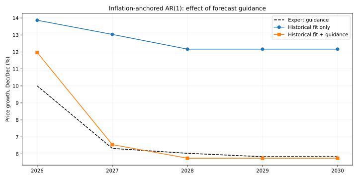

# Статистическая модель с экспертными ориентирами

Расчёт от 26.10.2026, факт — по сентябрь. Используются [исходные индекс цен ДОМ.РФ и ИПЦ](../inputs/monthly_data.csv). Для оценки доступны 67 месячных наблюдений с лагом: март 2021 — сентябрь 2026. Полных годовых приростов только четыре, поэтому параметры оцениваются на месячной истории, результат представлен по годам.

## Два параметра

Номинальный рост равен инфляции плюс реальный рост. Последний описывается авторегрессией:

$$
r_t=\mu+\phi(r_{t-1}-\mu)+\varepsilon_t,\qquad r_t=100\Delta\ln P_t-100\Delta\ln CPI_t.
$$

$\mu$ — долгосрочный месячный реальный рост, $\phi$ — инерция. Коэффициент при инфляции равен единице по предположению. На прогнозе ошибка принимается равной нулю. Ограничения: $-5\leq\mu\leq5$ лог. п.п./мес., $-0{,}95\leq\phi\leq0{,}95$. Отрицательная инерция допускает чередующееся затухание после сильного месяца; положительная сохраняет часть предыдущего темпа.

## Как учитываются ориентиры

$$
J=\frac{1}{N}\sum_t\left(\frac{r_t-\widehat r_t}{s}\right)^2+\frac{\lambda}{K}\sum_y\left(\frac{\widehat G_y-G_y^*}{q}\right)^2.
$$

Первая часть требует объяснять историю, вторая приближает прогноз к ориентирам. Здесь $N=67$, $K=5$; $s=1{,}388$ — исторический RMSE модели без ориентиров; $q=1$ п.п. годового роста — заданный масштаб. Это не доверительные интервалы. Ориентиры: 10% в 2026 году; в 2027–2030 годах инфляция плюс 1,5; 2,0; 1,8; 1,8 п.п.

Проверена сетка весов 0; 0,03; 0,1; 0,3; 1; 3; 10. Выбран вес с наименьшей дистанцией до ориентиров среди вариантов, ухудшающих исторический RMSE не более чем на 10%. Получено 0,3. Порог 10% — экспертное правило этого эксперимента; он не установлен через проверку будущих прогнозов. Результаты всей сетки доступны в [таблице](results/weight_sensitivity.csv).

| Параметр / метрика | Без ориентиров | С ориентирами |
|---|---:|---:|
| Долгосрочный реальный рост, лог. п.п./мес. | 0,6271 | 0,1358 |
| Инерция | 0,3159 | 0,1507 |
| Исторический месячный RMSE | 1,3880 | 1,4687 |
| Изменение исторического RMSE | — | +5,82% |

Прогноз начинается от фактического сентября. Уровни последовательно умножаются на $\exp[(\pi_t+\widehat r_t)/100]$, годовые темпы считаются по декабрьским уровням. Факт за девять месяцев 2026 года сохраняется. Используется исходный месячный профиль ИПЦ. Месячный расчёт нужен только для агрегирования и отдельно не публикуется. Поправка на математическое ожидание уровня после экспоненцирования не применяется: это условная траектория по логарифмам.

## Результат и ограничения

| Год | Ориентир | Без ориентиров | С ориентирами |
|---|---:|---:|---:|
| 2026 | 10,00% | 13,86% | 11,97% |
| 2027 | 6,32% | 13,03% | 6,54% |
| 2028 | 6,03% | 12,16% | 5,74% |
| 2029 | 5,83% | 12,16% | 5,74% |
| 2030 | 5,83% | 12,16% | 5,74% |

Ориентиры существенно меняют долгосрочный темп. Это совместная оценка по истории и сценарным предпосылкам; она сама по себе не доказывает структурное изменение рынка. Простая форма не воспроизводит затишье конца 2026 года достаточно сильно для результата 10% и не создаёт отдельного подъёма премии в 2028 году. При весе 10 исторический RMSE ухудшается на 61,3%, а дистанция до ориентиров всё равно составляет 0,38 п.п. RMSE. Усиление штрафа имеет измеримую цену.



Для модели без ориентиров проведена последовательная проверка на 32 двенадцатимесячных горизонтах с переоценкой на каждом шаге, минимум 24 наблюдения для обучения. RMSE годового роста: авторегрессия 7,49 п.п.; средний исторический реальный темп 7,45 п.п.; только инфляция 10,31 п.п. Авторегрессия не обошла простой средний темп.

В тесте всем моделям подаётся реализовавшаяся будущая инфляция: это условная проверка без ошибки прогноза ИПЦ. Горизонты перекрываются; 32 ошибки не являются независимыми годовыми экспериментами. Исторических версий экспертных ориентиров нет, поэтому прогнозная точность варианта с ориентирами не проверена. Его исторический RMSE — качество подгонки месячного уравнения, а не точность годового прогноза. Статистическая значимость коэффициентов не заявляется; устойчивость реального роста в разных режимах отдельно не установлена.

Дополнительно исключён по очереди каждый годовой ориентир при неизменном выбранном весе, параметры переоценены. При этом число ориентиров в функции потерь уменьшается до четырёх. Это проверка влияния предпосылок, не прогнозной точности. Проверены конечность результатов, стационарная граница, допустимое ухудшение исторического RMSE и совпадение рекурсии с формулой $r_{T+h}=\mu+\phi^h(r_T-\mu)$.

## Воспроизведение

Из корня репозитория:

```bash
python -m pip install -r price_forecast/requirements.txt
python price_forecast/statistical/model.py
```

Результаты сохраняются в `price_forecast/statistical/results/`.

- [Годовое сравнение](results/annual_comparison.csv)
- [Чувствительность к весу](results/weight_sensitivity.csv)
- [Оценки на истории](results/historical_fit.csv)
- [Исключение отдельных ориентиров](results/leave_one_guidance_out.csv)
- [Метрики проверки без ориентиров](results/baseline_backtest_metrics.csv)
- [Все ошибки этой проверки](results/baseline_backtest_folds.csv)
- [Параметры и диагностика](results/diagnostics.json)
